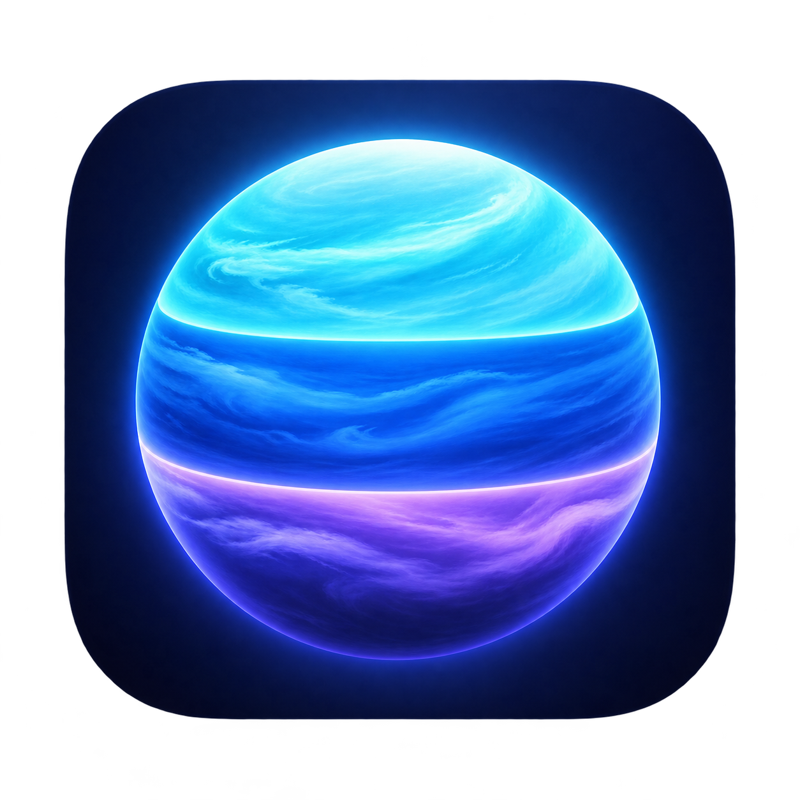

# Strato



Split an external Mac monitor into **two or three independent virtual displays**.
Choose **top / middle / bottom**, **left / center / right**, or automatic orientation.
Each zone has its own desktop and full-screen space.

Maintained by [Mehdi Alizadeh](https://github.com/DeamonCash).

Strato is based on [Eduardo Worrel’s Telas](https://github.com/eduardoworrel/telas).
The original author created the virtual-display, streaming and mouse-routing implementation.
This fork adds configurable thirds and a control window.

## What this fork adds

- Two or three zones per external monitor; three horizontal rows by default.
- Explicit orientation, including top / middle / bottom on portrait monitors.
- Shared rounded edges: thirds have no gaps or overlaps, including odd resolutions.
- Portrait monitors selected by default, alongside landscape monitors.
- A control window as well as the menu-bar controls.
- A screenshot button that captures the physical monitor with numbered zones.
- Updates signed with the same development certificate, when available, to preserve app identity.

```text
┌─────────────────────────┐
│       Virtual display 1 │
├─────────────────────────┤
│       Virtual display 2 │
├─────────────────────────┤
│       Virtual display 3 │
└─────────────────────────┘
```

**Experimental:** Strato uses Apple’s private `CGVirtualDisplay` API.
Verified on a MacBook Air M2 with macOS 26 and a portrait external monitor.
A video in full screen remained confined to the middle zone. This is not a guarantee
for every Mac, macOS version or protected video service.

## Build

Requires macOS 14 or later and Xcode Command Line Tools. There is no notarized release.

```sh
git clone https://github.com/DeamonCash/strato.git
cd strato
./build.sh
```

The script automatically selects an available Apple Development signing identity.
You can specify a certificate with `TELAS_SIGN_IDENTITY`.
If you have no certificate, an explicitly requested ad-hoc build is possible:

```sh
TELAS_SIGN_IDENTITY=- ./build.sh
```

Ad-hoc rebuilding changes the code identity and may require renewed macOS permissions.
For repeated updates, keep the same certificate, bundle identifier and app path.

Build directly into Applications with `./build.sh --install`.
Quit Strato and join its screens before rebuilding. Reopen the same app afterwards.
Use `TELAS_APP_PATH` to set a different destination.
A gitignored `.telas-build.env` file can retain local build settings.

## Permissions and use

1. Open Strato. Authorize **Accessibility** and **Screen Recording** in System Settings.
2. Reopen the app after macOS requests it. Both permissions should show checkmarks.
3. Select the external monitor, choose **3** and **Top / middle / bottom**, then **Split screens**.
4. Move windows into the virtual displays before enabling full screen.
5. Use **Join screens** to restore the physical monitor before changing layout.

The control window and menu-bar icon share the same settings. If the window is closed,
use **File → New Window** to reopen it.

**Emergency stop: Control + Option + Command + J.**

**Save screen screenshot** saves a local PNG in your Pictures folder and temporarily
numbers the zones. Screen contents are not uploaded by Strato.

If permissions appear enabled but Strato does not recognize them after replacing an old
ad-hoc build, remove only Strato’s old entries from the two permission lists, add the
current app again, and reopen it.

## Validation

```sh
swiftc Sources/RegionLayout.swift Tests/main.swift -o /tmp/telas-layout-tests
/tmp/telas-layout-tests
```

30 cases cover two and three zones, all orientations, portrait and landscape sizes,
negative monitor origins, contiguous edges and balanced integer dimensions.

## Limitations

- The built-in Mac display is not split.
- macOS may rearrange windows on all monitors when virtual displays appear or disappear.
- Existing full-screen windows are not moved automatically; leave full screen before splitting.
- Large windows are resized to fit and can remain smaller after joining.
- Live video streaming adds latency and GPU load.
- Screenshot sharing is enabled for the physical overlay windows in this fork.
- Changing the layout requires joining the screens first.

## License

[MIT](LICENSE). Original copyright: Eduardo Worrel.
